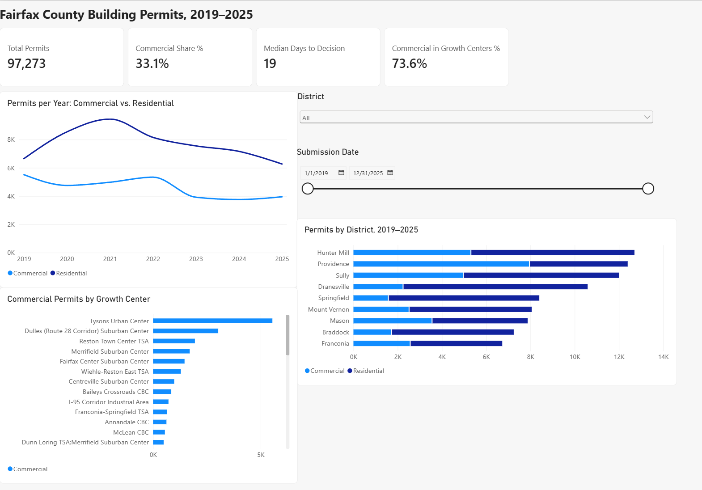

# Fairfax County Building Permits Analysis (2019–2025)

A Python, SQL, and Power BI project analyzing **141,000+ Fairfax County building permit records** to understand where development and business activity are happening, how fast permits are processed, and how activity has changed over time.



## Questions

1. Which parts of the county see the most permit activity, and how does commercial activity compare with residential? *(queries 01, 07)*
2. How has permit volume changed from year to year? *(queries 02, 06)*
3. How long does it take to get a permit decision, and does it vary by permit type? *(query 03)*
4. Did processing times change after the county's October 2022 move to its new permitting system (PLUS)? *(query 04)*
5. How much commercial activity happens inside the county's planned growth centers? *(query 05)*

## Data

- **Source:** [Building Records PLUS](https://data-fairfaxcountygis.opendata.arcgis.com/datasets/Fairfaxcountygis::building-records-plus), Fairfax County Open Data (downloaded November 2026)
- **Size:** 141,229 records, 31 columns
- **Analysis window:** 97,273 permits submitted 2019–2025 (see [Data decisions](#data-decisions))

## Pipeline

```
County Open Data (CSV)
        │
        ▼
src/explore.py         profile the raw data: missing values, duplicates, categories
        │
        ▼
src/clean_load.py      clean, derive new fields, load into SQLite
        │
        ▼
data/permits.db        normalized schema (sql/schema.sql)
        │
        ├──▶ queries/*.sql            SQL analysis (run with src/run_query.py)
        │
        └──▶ src/export_for_powerbi.py ──▶ dashboard/fairfax_permits.pbix
```

### Database design

A star schema with one fact table and three lookup tables, enforced with foreign keys and CHECK constraints:

| Table | Rows | Purpose |
|---|---|---|
| `permits` | 141,222 | One row per permit: dates, processing time, status |
| `record_types` | 6 | Permit type, category (Construction / Business Occupancy / Certificate of Occupancy), sector (Commercial / Residential) |
| `districts` | 9 | Supervisor districts |
| `growth_centers` | 42 | The county's planned growth areas (urban centers, suburban centers, transit station areas) |

### Cleaning steps

- Standardized column names (removed trailing colons and hidden spaces, converted to snake_case)
- Dropped 11 system and mapping columns
- Converted six date fields from text to dates and checked that no values were lost in conversion
- Verified the date fields against the submission date built into each permit ID (two-digit year plus day of year)
- Dropped 7 records with no supervisor district
- Calculated `days_to_decision` using the right date for each permit type:
  - Construction permits: issued date − submitted date
  - Business occupancy (Non-RUP) approvals: approved date − submitted date
  - Regular certificates of occupancy: not timed (too many missing dates)
- Removed 78 impossible (negative) processing times
- Loaded into SQLite with 0 foreign key violations

## Key findings

**1. Permit activity is concentrated in the northern districts.**
Hunter Mill (14.9%), Providence (14.7%), and Sully (14.7%) are essentially tied, and with Dranesville they account for 58% of all permits from 2019 to 2025.

**2. About three-quarters of commercial activity happens inside the county's planned growth centers.**
73.6% of commercial permits fall in a growth center, compared with about 41% of all permits. Tysons alone accounts for 17.2% of commercial activity, followed by the Dulles/Route 28 corridor (9.4%) and the two Reston Metro station areas (10.0% combined). Wiehle-Reston East has the highest share of new commercial construction among the leading centers.

**3. Providence (Tysons) leads commercial activity every year.**
Providence ranked #1 for commercial permits in every year from 2019 to 2025, and it accounted for most of the county's commercial growth in 2025 (+161 of +195 permits). Sully, along the Dulles corridor, has held #2 since 2023.

**4. Overall volume peaked in 2021 and has declined since, but the sectors move differently.**
Total permits fell 33% from 2021 to 2025, driven mainly by residential activity (−34%). Residential surged during the pandemic (+28.5% in 2020) while commercial dipped. Commercial fell sharply in 2023 (−26.6%) and was the only sector to grow in 2025 (+5.2%).

**5. New commercial buildings take the longest to permit. Most businesses moving into existing space are approved the same day.**

| Permit type | Median days | Average days | Over 90 days |
|---|---|---|---|
| Commercial New | 128 | 237 | 55% |
| Residential New | 57 | 94 | 35% |
| Commercial Addition/Alteration | 43 | 73 | 25% |
| Residential Addition/Alteration | 14 | 34 | 8% |
| Business Occupancy (Non-RUP) | 0 | 8 | 2% |

59% of business occupancy approvals happen on the day they're submitted. The median is used because a small number of very long cases pull the average up.

**6. Processing times have been stable since 2021, with two short disruptions.**
The median for construction permits has held at about 22–28 days since 2021. It jumped from 7 to 37 days at the start of the COVID-19 pandemic (2020 Q2), and briefly rose to 41 days in 2022 Q4, the quarter the county moved building records to PLUS, before returning to 26 days the next quarter.

## Data decisions

- **Analysis limited to 2019–2025.** Records before 2019 are few and mostly commercial, which suggests they're a partial set carried over from the county's earlier permitting system rather than complete activity. 2026 is a partial year.
- **Median instead of average** for processing times, because the distributions have long tails.
- **Regular certificates of occupancy** are counted but not timed, because 44% have no submitted date and 70% have no issued date.

## Limitations

- The public dataset doesn't include project cost, so the analysis measures activity by permit count, not dollar value.
- Recent permits that are still in review are likely underrepresented, which may make the most recent periods look slightly faster.
- 9,240 records have no submitted date and are excluded from time-based analysis.
- Nine growth-center values combine two or three adjacent areas (for example, "Wiehle-Reston East TSA;Reston Town Center TSA"). They were kept as separate categories to avoid double-counting, so totals for some individual centers are slightly understated.
- The explanations for the patterns (the pandemic, interest rates, the system change) are context, not causes proven by this data.

## SQL techniques used

| Query | Question | Techniques |
|---|---|---|
| `01_permits_by_district.sql` | Permits by district | JOIN, GROUP BY, window function for share of total |
| `02_permits_by_year.sql` | Permits by year and sector | strftime, conditional aggregation (CASE WHEN) |
| `03_processing_time_by_type.sql` | Median processing time by type | CTE, ROW_NUMBER, COUNT OVER, manual median |
| `04_processing_time_by_quarter.sql` | Processing time by quarter | Chained CTEs, PARTITION BY |
| `05_growth_centers_commercial.sql` | Commercial activity by growth center | LEFT JOIN, COALESCE |
| `06_year_over_year_change.sql` | Year-over-year change | LAG, named WINDOW |
| `07_district_commercial_rank.sql` | Top districts each year | RANK, filtering on a window function |

## Dashboard

`dashboard/fairfax_permits.pbix` (Power BI Desktop) includes:
- KPI cards: total permits, commercial share, median days to decision, commercial share in growth centers
- Permits per year, commercial vs. residential
- Permits by district, split by sector
- Commercial permits by growth center
- Slicers for district and submission date

The model mirrors the SQLite star schema, with DAX measures built using `COUNTROWS`, `MEDIAN`, `CALCULATE`, and `DIVIDE`.

## How to run

1. Download the [Building Records PLUS CSV](https://data-fairfaxcountygis.opendata.arcgis.com/datasets/Fairfaxcountygis::building-records-plus) and save it as `data/raw/building_records_plus.csv`.
2. Set up the environment:
   ```
   python -m venv venv
   venv\Scripts\activate          # Windows
   pip install -r requirements.txt
   ```
3. Build the database:
   ```
   python src/clean_load.py
   ```
4. Run any query:
   ```
   python src/run_query.py queries/01_permits_by_district.sql
   ```
5. Export data for Power BI and open the dashboard:
   ```
   python src/export_for_powerbi.py
   ```
   Then open `dashboard/fairfax_permits.pbix`.

## Tools

Python (pandas, sqlite3), SQLite, SQL, Power BI (DAX), Git/GitHub
